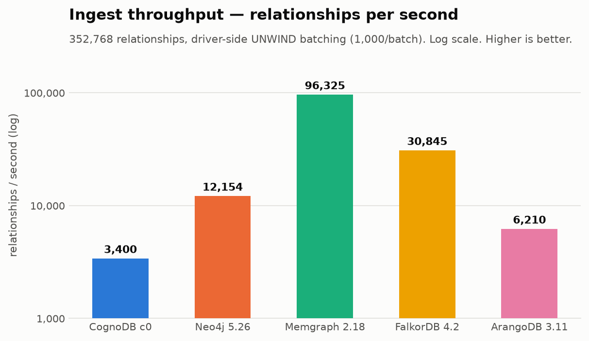
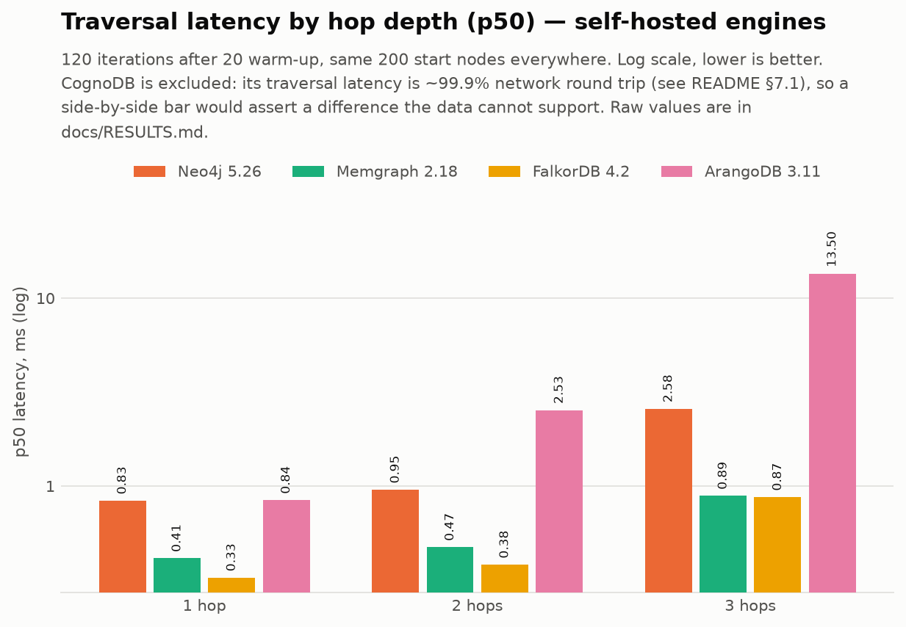
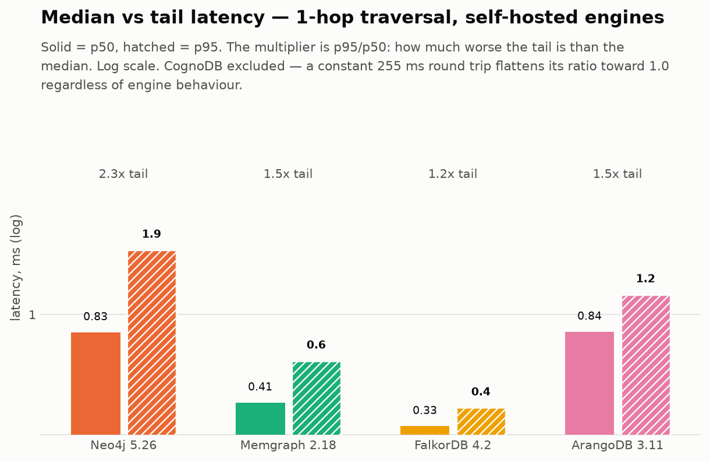
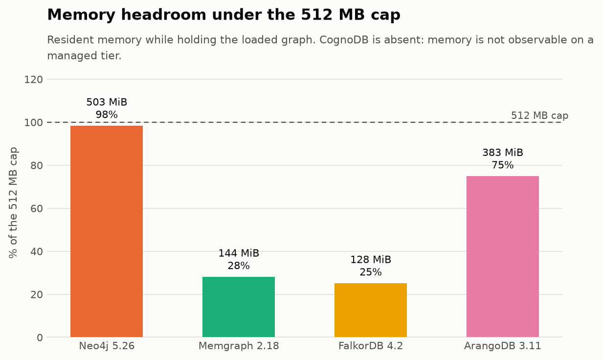
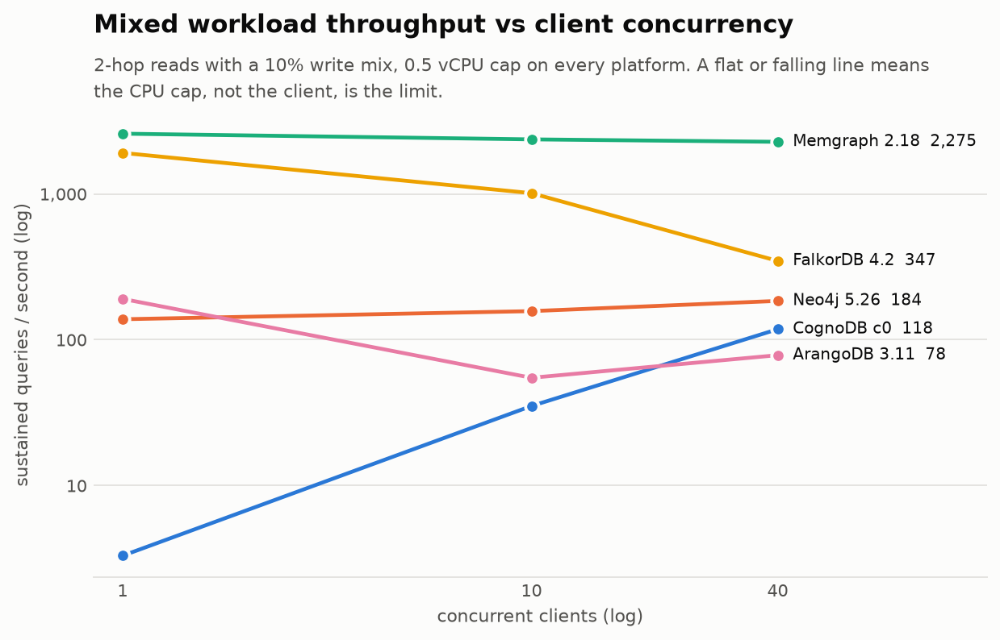

# Graph Database Cloud Benchmark — CognoDB vs four others

A reproducible, deliberately honest benchmark of **CognoDB Cloud** against **Neo4j,
Memgraph, FalkorDB and ArangoDB**, all held to the same resource ceiling, on the
same dataset, with the same logical queries.

> **The single most important finding is a methodological one, and it is not
> flattering to the benchmark itself:** measured from a laptop in Bengaluru, a
> 1-hop and a 2-hop traversal against CognoDB in Virginia came out **0.5 ms
> apart** (245.98 ms vs 246.50 ms) — and in an earlier probe the 2-hop measured
> *faster* than the 1-hop, which is physically impossible. A 2-hop traversal
> visits everything a 1-hop does and then keeps going. The ~250 ms network round
> trip is two orders of magnitude larger than the real work, so the measurement
> is noise. Read [§7 Caveats](#7-caveats--what-this-benchmark-cannot-tell-you)
> before you trust a single traversal latency for CognoDB.

---

## 1. What was measured

| Category | Metric | Status |
|---|---|---|
| Data loading | nodes/s, rels/s, total wall clock | ✅ all 5 platforms |
| Traversals | 1/2/3-hop, p50 + p95 | ✅ all 5 platforms |
| Lookups | point lookup + indexed filter, p50 + p95 | ✅ all 5 platforms |
| Aggregations | group-by and count, p50 + p95 | ✅ all 5 platforms |
| Mixed workload | concurrent read/write QPS at 1 / 10 / 40 clients | ✅ see results |
| Footprint | memory + on-disk, or explicit "not observable" | ✅ all 5 platforms |

Full numbers: **[docs/RESULTS.md](docs/RESULTS.md)** — generated from raw JSON by
`report.py`, never hand-typed.

Advertised platform specs and the CognoDB capability probe:
**[docs/PLATFORM_SPECS.md](docs/PLATFORM_SPECS.md)**.

A narrative write-up aimed at a general technical audience:
**[ARTICLE.md](ARTICLE.md)**.

### At a glance





**Why CognoDB is absent from the two latency charts.** Its raw traversal p50 is
254.85 ms against a 254.81 ms no-op baseline — 99.98% of that number is the round
trip. Drawing it beside a localhost engine would assert "700× slower", which is
false; excluding it from the p95/p50 chart likewise avoids advertising a 1.3× tail
ratio that only reflects constant network latency. **The raw values are all present
in [docs/RESULTS.md](docs/RESULTS.md)**, next to the caveat. Declining to draw a
comparison the data cannot support is not the same as hiding it.

The chart below is worth dwelling on: Neo4j's *median* is competitive while its
tail is not. Note that the specific workload carrying the spike moves between runs
(see [§6.1](#61-memory-headroom-not-engine-design-predicts-tail-latency)) — the
chart shows one run, and the ratio column in §6.1 is the aggregate view.





Two different phenomena share the next chart. Every self-hosted engine is flat or
falling — 0.5 vCPU is saturated by the first client. CognoDB climbs steeply, which
looks like excellent scaling and is actually 243 ms of per-client network dead air
being filled in. See [§7.1](#71-cognodb-was-measured-across-a-wan-the-comparators-were-not-️).



Charts are regenerated from raw JSON by `charts.py`. The categorical palette is
validated for colour-vision deficiency (worst adjacent-pair CVD ΔE 9.1,
normal-vision ΔE 19.6); every mark carries a value label so identity and magnitude
never depend on colour alone.

---

## 2. Why these four comparators

The brief lets you pick any four. Picking four Cypher engines would have been
easier and worse — a finding that reproduces across four dialects of the same
language tells you much less than one that survives a change of language.

| Platform | Why it earns a slot |
|---|---|
| **Neo4j 5.26 Community** | The reference Bolt/Cypher implementation. CognoDB advertises drop-in Neo4j-driver compatibility, so this is the direct baseline — and the one place where "does the compatibility claim hold?" can actually be tested. |
| **Memgraph 2.18** | In-memory C++ engine, the architectural opposite of a disk-backed store. Directly tests whether "in-memory" is viable when RAM is the binding constraint at 512 MB. |
| **FalkorDB 4.2** | GraphBLAS sparse-matrix execution over the Redis protocol. A genuinely different execution model, so hop-depth scaling should diverge for structural reasons rather than tuning ones. |
| **ArangoDB 3.11** | Multi-model document store with a graph layer, queried in **AQL, not Cypher**. Costs an entire second adapter and a hand-written query translation — the price of finding out which results are engine properties and which are Cypher artefacts. |

CognoDB is the subject under test, not a comparator.

---

## 3. Fairness: same resources everywhere

CognoDB's free `c0` tier is the smallest box in the comparison, so it sets the
ceiling for everyone. Every comparator is capped by the **container runtime** —
not by trusting each engine's own config — in [docker-compose.yml](docker-compose.yml):

```yaml
cpus: "0.5"
mem_limit: 512m
```

| Resource | CognoDB c0 (console-verified) | Every comparator |
|---|---|---|
| Memory | 512 MB | 512 MB (`mem_limit`) |
| vCPU | burst to 0.5 | 0.5 (`cpus`) |
| Disk | 1 GiB | 1 GiB budget, dataset uses far less |
| Region | us-east4 | see caveats — **this is where parity breaks** |

**A discrepancy worth flagging:** the assignment PDF states the free tier has
**256 MB** RAM. Both cognodb.com and the live console state **512 MB**. Comparators
are capped at the console-verified 512 MB, because that is what the instance under
test actually has. Capping comparators at 256 MB while CognoDB ran with 512 MB
would have been the real methodology error.

Engine-level memory settings are additionally tuned inside that cap (Neo4j heap
200 MB + pagecache 96 MB, Memgraph `--memory-limit=400`), because a JVM or an
in-memory store that is unaware of its cgroup limit gets OOM-killed rather than
degrading gracefully. Those settings are visible in the compose file and are part
of the reported configuration.

---

## 4. Dataset

**SNAP cit-HepTh** — the Arxiv High-Energy-Physics-Theory paper citation network.
<https://snap.stanford.edu/data/cit-HepTh.html>

| | |
|---|---|
| Nodes | **27,769** `(:Paper {id, date, year})` |
| Relationships | **352,768** `(:Paper)-[:CITES]->(:Paper)` |
| Raw source | `cit-HepTh.txt.gz` + `cit-HepTh-dates.txt.gz`, SHA-256 pinned in `data/MANIFEST.json` |
| Load method | driver-side `UNWIND` batching, 1,000 rows/batch, **identical on all five platforms** |

Why this dataset:
- It clears the 100k-relationship floor and sits in the recommended 100k–500k band.
- It fits **Neo4j AuraDB Free's 400k-relationship cap**, keeping a managed-vs-managed
  comparison possible as a future extension. A larger graph would have silently
  disqualified a credible comparator.
- The companion dates file provides a *real* property to index, so the
  filtered-lookup metric measures an index rather than a synthetic column.

### Cleaning, and what it cost

`prep_dataset.py` produces the one canonical dataset every loader reads:

- **Cross-listed ids normalised.** SNAP encodes cross-listed papers as `11<true_id>`
  in the dates file but not in the edge file. Without collapsing these, the same
  paper exists as two nodes and hop counts are wrong. Normalising raised
  date-join coverage from 8,326 to 11,441 nodes.
- **39 self-loops removed**, 0 duplicate edges found.
- Node count is 27,769 rather than SNAP's advertised 27,770 because one node
  appeared only in a self-loop.
- **Only 11,441 of 27,769 nodes (41%) have a publication date.** The SNAP dates
  snapshot predates the edge list, so 2002–03 papers are largely undated. This is
  a property of the source data, identical on every platform, and it still leaves
  a usefully selective index (`year = 2000` → 3,050 nodes).

Start nodes are sampled **once**, deterministically (seed 42, out-degree ≥ 3, 200
nodes) into `data/start_nodes.json`, and every platform traverses from that same
set. Requiring out-degree ≥ 3 stops multi-hop queries dead-ending on leaf nodes
and reporting a misleadingly fast p50.

---

## 5. Reproducing this

### Prerequisites
- Python 3.12, Docker, ~2 GB free disk
- A CognoDB free instance (<https://console.cognodb.com/signup>)

### Run it

```bash
# 1. Install pinned dependencies
uv venv --python 3.12 && uv pip install -r requirements.txt

# 2. Secrets — never committed; .env is gitignored
cp .env.example .env      # then fill in your own values

# 3. Fetch and canonicalise the dataset (verifies SHA-256)
mkdir -p data/raw && cd data/raw \
  && curl -sSLO https://snap.stanford.edu/data/cit-HepTh.txt.gz \
  && curl -sSLO https://snap.stanford.edu/data/cit-HepTh-dates.txt.gz && cd ../..
.venv/bin/python prep_dataset.py

# 4. Everything: comparators up, load, read, mixed, footprint, report
./run_all.sh
```

Or drive a single platform:

```bash
.venv/bin/python run.py baseline --platform cognodb
.venv/bin/python run.py load     --platform cognodb --wipe
.venv/bin/python run.py read     --platform cognodb --iterations 120 --warmup 20
.venv/bin/python run.py mixed    --platform cognodb --concurrency 1,10,40
.venv/bin/python footprint.py --cognodb-storage-mb <read from console>
.venv/bin/python report.py
```

Secrets are read from environment variables only. No connection URI or password
appears anywhere in this repository.

---

## 6. Analysis — what the numbers show, and why

See [docs/RESULTS.md](docs/RESULTS.md) for the full matrix. The findings that
survive scrutiny:

### 6.1 Memory headroom, not engine design, predicts tail latency

The footprint table is the key to the whole benchmark. `p95/p50` is reported two
ways deliberately: the **median** ratio across the seven read workloads (typical
tail behaviour) and the **worst** single workload (how bad it gets).

| Platform | Memory used | % of 512 MB cap | median p95/p50 | worst p95/p50 |
|---|---|---|---|---|
| Neo4j | 503 MiB | **98%** | **3.6×** | **31.5×** (3-hop) |
| ArangoDB | 383 MiB | 75% | 2.5× | 11.6× (3-hop) |
| Memgraph | 144 MiB | 28% | 1.5× | 6.0× (3-hop) |
| FalkorDB | 128 MiB | 25% | **1.3×** | 12.3× (group-by) |

The ordering of the median-ratio column is exactly the ordering of the memory
column. Neo4j runs at 98% of its cap and has both the worst typical tail and the
worst spike; FalkorDB at 25% is nearly flat. A 200 MB heap holding this graph plus
query state collects constantly, and each collection lands on some unlucky query.

**An important correction to an earlier version of this analysis.** I first
measured Neo4j's 1-hop p95 at 52× its p50 and wrote that up as "Neo4j's p95 is ~50×
its median". A repeat run did not reproduce it: 1-hop came back at 2.3×, while
3-hop hit 31.5× and group-by 16.7×. **The spikes are real, large, and consistent
in aggregate — but which workload absorbs them varies between runs.** That is
itself the signature of GC pauses landing stochastically rather than a specific
query being slow. Quoting a single workload's ratio was over-claiming from one
sample; the two-column table above is what the data actually supports.

**The practical lesson: on a small tier, pick the engine whose memory model fits
the box, not the one with the best median.** A p50 you can quote and a p95 your
users feel are different numbers — and a p95 measured once is not a p95.

### 6.2 A 0.5 vCPU cap makes concurrency scaling almost meaningless

Memgraph served ~2,588 QPS at one client and *fell* to ~2,275 at forty. It does
not scale with concurrency because there is nothing to scale onto — half a core
is saturated by the first client, and the other thirty-nine only add contention.
Neo4j moved from 138 to 185 QPS across the same sweep, a rise that mostly
reflects hiding its own latency rather than using more CPU.

Concurrency sweeps on free tiers measure the client's ability to hide latency far
more than they measure server capacity. Worth running; not worth over-reading.

### 6.3 Query-language equivalence is not cost equivalence

`agg_rel_count` is the clearest case. In Cypher, `MATCH (:Paper)-[:CITES]->(:Paper)
RETURN count(*)` constrains the label at both endpoints and forces a real scan of
every relationship. The natural AQL equivalent can be answered from collection
metadata. ArangoDB returns it in ~17 ms against 85–185 ms for the Cypher engines —
and that gap is a *query planning* difference, not a throughput difference.

This is flagged in the code itself (`not_comparable` on the workload definition)
and in the results table, rather than presented as a win. It is also the reason
ArangoDB was worth the cost of a second adapter: without a non-Cypher engine in
the panel, this class of artefact is invisible.

I also predicted, before measuring, that Neo4j would answer this query from its
count-store in ~1 ms. It took 185 ms — the count-store only applies to
unlabelled patterns. **The prediction was wrong and the measurement corrected
it**, which is the entire reason for measuring.

### 6.4 CognoDB: what can and cannot be said

What can be said with confidence, because it sits far above the noise floor:

- CognoDB's `agg_rel_count` costs **~1,613 ms of server-side time** against 85 ms
  (Memgraph), 85 ms (FalkorDB), 185 ms (Neo4j) and 17 ms (ArangoDB). Even with a
  243 ms round trip subtracted and generous error bars, this is roughly an order
  of magnitude slower than the self-hosted engines. It has no count-store-style
  shortcut and no obvious scan optimisation.
- It **completed every workload with zero failures**, including a full 352,768-
  relationship load, and its per-batch ingest latency showed no throttling cliff
  across 353 consecutive batches — burst credits held for the whole run.
- Its ingest, corrected for round trip, implies **~30,000 rels/s** of server-side
  capability (33 ms of server time per 1,000-row batch). That would place it
  between FalkorDB and Memgraph — but this is an *inference from a corrected
  measurement*, not a measurement.

What **cannot** be said: anything about its traversal or lookup latency. Those
workloads cost 1–6 ms server-side against a 243 ms round trip with ~9–22 ms of
jitter. The noise is larger than the signal by an order of magnitude. See §7.

### 6.5 The compatibility claim mostly holds, with sharp edges

CognoDB works with the unmodified official Neo4j driver, and the entire Cypher
workload suite ran against it unchanged. But it is **not Neo4j underneath**, and
the differences are load-bearing:

- Exactly **10 procedures** are registered. `dbms.components()`,
  `SHOW PROCEDURES` and `db.schema.visualization()` do not exist.
- **No `apoc.periodic.iterate`** — the standard Neo4j bulk-load workhorse. As it
  happens this *helped* the benchmark, forcing driver-side batching, which is the
  one load method all five platforms support identically.
- **No `db.awaitIndexes()`**, and `SHOW INDEXES.state` returns `null`. Index
  readiness is therefore *unverifiable*; the harness waits a fixed interval and
  records that it could not confirm. Every other platform in this comparison can
  prove its indexes are live.
- `USING PERIODIC COMMIT` is unsupported.
- A hard **50,000-row result cap** — which is why every traversal in this suite
  returns an aggregate rather than rows.

Present and interesting for a 512 MB tier: vector indexes, full-text indexes, and
GDS procedures (Louvain, Dijkstra). CognoDB is positioned as a graph engine for
AI workloads, not as a Neo4j clone, and its procedure list reflects that choice.

---

## 7. Caveats — what this benchmark cannot tell you

Listed in descending order of how much they should change your reading. The first
one is severe.

### 7.1 CognoDB was measured across a WAN; the comparators were not. ⚠️

This is the benchmark's central limitation and it is not fully repairable with
the setup available.

| | CognoDB | Comparators |
|---|---|---|
| Location | GCP us-east4 (Virginia) | Docker on the client machine |
| Client | Bengaluru, India | localhost |
| no-op RTT p50 | **~243 ms** | 0.23 – 5.6 ms |
| RTT stdev | ~9–22 ms | < 1 ms |

The brief requires the same client machine *and region* for every platform. That
requirement is **not met**, because it needed a cloud VM in us-east4 and no
zero-cost account was available before the deadline.

Mitigation, and its limits: every phase records its own no-op baseline on a
reused session, and `p50_net_of_rtt_ms` is reported for every workload. This works
for CognoDB's aggregation numbers, where server-side cost (~1,613 ms) dwarfs both
the round trip and its jitter. It **does not** work for traversals and lookups,
where 1–6 ms of server work is buried under ~15 ms of jitter. The harness detects
this itself and stamps `MEASUREMENT INVALID FOR PUBLICATION` into the result JSON
whenever the baseline exceeds 20 ms.

**Treat CognoDB's traversal and lookup rows as not-yet-measured.** The fix is one
command from a us-east4 VM — `run.py` takes the target from an env var and the
harness is otherwise unchanged.

### 7.2 Comparators ran on the client's own CPU
The four Docker engines were capped to 0.5 vCPU / 512 MB, but they shared a host
with the benchmark client. Client CPU use can inflate their latency; equally,
localhost transport flatters them. Both effects are real and they push in
opposite directions.

### 7.3 Not every engine ships the same defaults
FalkorDB enforces a **1,000 ms query timeout** and a **10,000-row result cap** out
of the box, versus CognoDB's 50,000-row cap. Engines were left at their shipped
defaults rather than normalised, on the grounds that shipped defaults are what a
user actually gets. No query in this suite hit either limit.

### 7.4 "Cold" here means plan compilation, not process cold start
Because the connection is already established and earlier workloads have warmed
the engine, `first_exec_of_query_ms` captures query planning only. True
process-cold-start numbers would require restarting each engine between
measurements and were not collected. The column is named to prevent overclaiming.

### 7.5 Single run per configuration — with measured evidence of why that matters
Reported numbers are one run per configuration, not a distribution over repeated
runs. Where a configuration *was* run twice, the spread was large:

| Measurement | Run 1 | Run 2 | Spread |
|---|---|---|---|
| Neo4j ingest (rels/s) | 7,334 | 12,154 | **+66%** |
| Memgraph ingest (rels/s) | 73,460 | 96,325 | **+31%** |
| Neo4j no-op baseline (ms) | 1.60 | 5.58 | **3.5×** |
| Neo4j 1-hop p95/p50 | 52× | 2.3× | **23×** |

Same hardware, same dataset, same code. The tables report the second (current)
run; the first is preserved here rather than discarded. Contributing factors: JVM
warm-up state, container uptime, and host cache state — the second Neo4j load ran
against a container that had been up 22 hours.

**Consequence: do not rank platforms whose numbers differ by less than ~2×.**
Memgraph vs FalkorDB on ingest (96k vs 31k) is outside that band. Neo4j vs
ArangoDB on ingest (12.2k vs 6.2k) is marginal. A proper treatment needs n≥5 runs
per configuration with confidence intervals; that is the first thing I would add
with more time.

### 7.6 CognoDB memory is not observable
No host access and no `dbms.*` memory procedure. The console exposes node,
relationship and storage counters but has no public API, so storage is recorded
via a manual reading. Memory usage is marked "not observable" rather than guessed.

### 7.7 ArangoDB's index parity is structural, not identical
`_key` carries ArangoDB's mandatory primary index, used as the equivalent of the
`:Paper(id)` index on the Cypher engines. It is recorded as 0 ms creation time
because it cannot be created or dropped — not because indexing was skipped. The
`year` index is an explicit persistent index built with `in_background=False`.

---

## 8. Repository layout

```
bench.py            Harness: dataset access, percentiles, and one adapter per engine family
run.py              CLI — baseline | load | read | mixed
prep_dataset.py     Raw SNAP -> canonical dataset + SHA-256 manifest + start nodes
footprint.py        Footprint capture (docker stats + du; manual console value for CognoDB)
report.py           Generates docs/RESULTS.md from results/*.json
docker-compose.yml  Four comparators, each capped to 0.5 vCPU / 512 MB
run_all.sh          One-command full run
data/MANIFEST.json  Dataset provenance, checksums, counts, cleaning decisions
results/*.json      Raw measurements, including harness-generated caveats
docs/RESULTS.md     Generated results matrix
docs/PLATFORM_SPECS.md  Advertised specs + CognoDB capability probe
```

Recon scripts kept deliberately (`smoke_test.py`, `recon.py`, `probe_ddl.py`) —
they document how the engine's actual capabilities were established rather than
assumed, and they are how anyone would verify the §6.5 claims independently.

---

## 9. Honest summary

At 512 MB and half a core, on this dataset:

- **Memgraph** is the fastest all-rounder — best ingest (96k rels/s), best
  traversal medians, most throughput, and it fits in 28% of the cap.
- **FalkorDB** has the best *predictability* — p95 barely above p50 — at the cost
  of near-zero durable footprint by design.
- **ArangoDB** is competitive but its planner makes some comparisons meaningless
  in either direction; read the per-workload notes before quoting it.
- **Neo4j** has fine medians and the worst tails in the group (median p95/p50
  3.6×, worst 31.5×), driven by running at 98% of its memory cap rather than by
  engine design. Give it more memory and this likely inverts.
- **CognoDB** delivered a fully correct, zero-failure run of every workload and
  showed no free-tier throttling. Its aggregation path is roughly an order of
  magnitude slower than the self-hosted engines. **Its traversal and lookup
  latencies remain unmeasured** — not slow, *unmeasured* — because the client was
  13,500 km away. That gap is the honest headline of this submission.

Nobody "wins" a benchmark run on a free tier from the wrong continent. What this
repository does provide is a harness where fixing that costs one environment
variable and one re-run.
